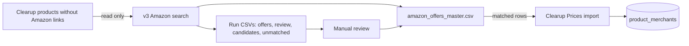
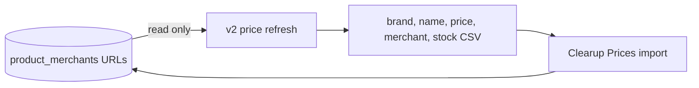

# Phase 5: Amazon offers

Amazon discovery adds a retailer link to an existing Clearup product. Price refresh later reads that saved link. The scraper writes CSVs; Clearup imports them through Admin → Imports → Prices.

The master has one row per Clearup `productId`. Only `status=matched` is importable; `review`, `unmatched`, and `error` stay out. The importer checks the product ID against the row's brand and name. `Amazon.ca` maps to Clearup's `Amazon` merchant. A matched offer can retain its `website` when its price is unavailable.

Until offers are imported, `refresh prices --master` reads matched URLs from `amazon_offers_master.csv` and updates that local master. A loaded Amazon page without a price produces `price=-1,stock=false`; Clearup converts `-1` to a nullable merchant price. Failed page requests produce no refresh row.

## Saved-data smoke check — 2026-11-02

Checked `outputs/catalog/amazon_offers_master.csv` and `outputs/refresh/amazon_refresh.csv` without connecting to the database:

| File | Result |
| --- | --- |
| Amazon master | 14 rows: 10 matched, 1 review, 3 unmatched. All matched rows have a website and unique product IDs. Nine matched prices contain `$`; one is `-1`. |
| Amazon refresh | 5 rows: four prices contain `$`; one is `-1` with `stock=false`. |

**Import blocker:** The current Clearup branch parses prices with `Number(row.price)`. That rejects values like `$30.23` in both files. It also reads an empty price as `0`, so a future matched link with no price would not become `NULL`. The master has no `stock` column; the current importer defaults a new `-1` offer to `stock=true`.

Before uploading the master to staging, Clearup should parse the scraper's currency format, map empty matched prices and `-1` to `NULL`, and mark unpriced new offers as unavailable or unverified. Then import a few matched rows and confirm their product IDs against the staging catalog. This check did not run the importer, migration, browser scraper, or a database write.
